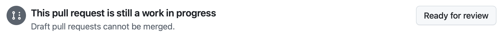

| [← Ejercicio anterior: Gestionar agentes][previous-lesson] |
|:--|

## Revisar el trabajo

Durante este taller has trabajado con GitHub Copilot en varias tareas para mejorar la experiencia y añadir funciones: documentar el código, crear una sección de juegos relacionados y añadir funciones de accesibilidad con modos de alto contraste y claro. Ahora revisarás los cambios y, si hace falta, pedirás a Copilot que los mejore.

### Escenario

Los principios de diseño de software y DevOps no cambian con la IA generativa. Hay que revisar el código generado y seguir el proceso habitual. Revisarás las propuestas de Copilot antes de activar la revisión para el resto del equipo.

## Seguridad y agente en la nube de GitHub Copilot

Como el agente en la nube trabaja de forma asíncrona y sin supervisión, se aplican algunas restricciones de seguridad:

- Copilot solo tiene acceso de lectura al repositorio y acceso de escritura **únicamente** a la rama que utiliza para el código.
- El agente se ejecuta en GitHub Actions, en un entorno efímero independiente.
- Una persona debe aprobar los flujos de GitHub Actions antes de que se ejecuten.
- [El acceso a recursos externos está limitado de forma predeterminada][agent-firewall], incluidos los servidores Model Context Protocol (MCP).

## Revisar la documentación generada

Empieza por la primera solicitud de incorporación de cambios (PR) generada por el agente: la que añade documentación al código. La revisarás en la interfaz habitual de PR de GitHub.com.

> [!NOTE]
> Puede aparecer un aviso de que el cortafuegos bloqueó a GitHub Copilot. Es lo esperado, ya que el acceso a recursos externos, incluidas las llamadas a servidores MCP externos, está limitado de forma predeterminada. Si quieres, puedes [personalizar o deshabilitar el cortafuegos del agente en la nube][agent-firewall].

1. Vuelve al repositorio en github.com.
2. Selecciona **Pull Requests** para abrir la lista.
3. Abre la solicitud cuyo título sea parecido a **Add missing documentation**.

> [!NOTE]
> Si Copilot sigue trabajando, la PR incluirá la marca **[WIP]**. Espera a que termine; puede tardar varios minutos.

4. Cuando la PR esté lista, selecciona **Files changed** y revisa los cambios.

   

5. Explora el código actualizado, que incluirá comentarios de documentación TypeScript (TSDoc) y otra documentación. Los cambios concretos pueden variar. Comprueba los comentarios TSDoc, las convenciones de TypeScript y los encabezados de archivo que proceden de los archivos de instrucciones revisados en el ejercicio 2.
6. Cuando hayas revisado los cambios, vuelve a **Conversation** y desplázate hacia abajo.
7. Comprueba si hay flujos de trabajo pendientes de aprobación.
8. Si los hay, selecciona **Approve and run workflows**.

   

9. Comprueba que los flujos de trabajo se han puesto en cola en la sección de comprobaciones de la PR. Si todo va bien, las comprobaciones del proyecto para la aplicación Astro terminarán correctamente; pueden tardar unos minutos.

## Solicitar cambios a GitHub Copilot

Puedes mencionar a Copilot en comentarios de la PR, igual que a otros miembros del equipo, o añadir comentarios en línea al código. Copilot utilizará esos comentarios para iniciar otra sesión y resolverlos. Como los resultados no son deterministas, no hay un prompt único. Puedes pedir, por ejemplo, que:

- añada al principio de cada archivo de código un comentario breve sobre su propósito.
- añada comentarios TSDoc a archivos TypeScript y Astro.
- cree un README que describa la estructura de la aplicación Astro.

1. Añade un comentario y menciona a **@copilot**. Usa una de las sugerencias anteriores u otra petición sobre la documentación del código.
2. Selecciona **View Session** para observar cómo Copilot inicia otra sesión y aplica los cambios.
3. Selecciona **Back to pull request** para volver a la PR.

   
4. Cuando Copilot termine, confirma que hay un commit nuevo.
5. Selecciona **Files changed** y revisa los cambios.

Puedes seguir iterando hasta que estés conforme. Después, puedes marcar la PR como lista para revisión y combinarla en la rama principal.



## Revisar la funcionalidad de juegos relacionados

Revisa la PR que Copilot creó para mostrar juegos relacionados en la página de detalles.

1. Vuelve al repositorio en GitHub.com.
2. Selecciona la pestaña **Pull Requests**.
3. Abre la PR cuyo título sea parecido a **Show related games on the game details page**.
4. Selecciona **Files changed** y revisa el código generado.
5. Cuando hayas revisado los cambios, vuelve a **Conversation** y desplázate hacia abajo.
6. Comprueba si hay flujos de trabajo pendientes de aprobación y, si los hay, selecciona **Approve and run workflows**.

   

7. Confirma que las comprobaciones del proyecto terminan correctamente. Puede tardar unos minutos.
8. **Opcional:** cambia a la rama de Copilot en tu Codespace para probar manualmente la funcionalidad. Sustituye `<branch-name>` por el nombre de la rama creada por Copilot, por ejemplo, `copilot/fix-8`:

   ```bash
   git fetch origin
   git checkout <branch-name>
   ```

Copilot ha creado la funcionalidad de juegos relacionados. Puedes pedir cambios mediante comentarios nuevos en la pestaña **Conversation**, como ajustar el número de juegos mostrados o añadir encabezados y comentarios TSDoc. Ten en cuenta que esta tarea se asignó antes de actualizar las instrucciones personalizadas.

## Revisar las funciones de accesibilidad

Por último, revisa las funciones implementadas con el agente personalizado de accesibilidad. La PR debe incluir tanto el modo de alto contraste asignado en el ejercicio 3 como el modo claro solicitado desde el centro de control en el ejercicio 4.

1. Vuelve al repositorio en GitHub.com.
2. Selecciona la pestaña **Pull Requests**.
3. Abre la PR cuyo título sea parecido a **Add high contrast mode to website**. Si Copilot sigue trabajando, espera a que desaparezca **[WIP]**.
4. Selecciona **Files changed** y revisa el código.
5. Examina la implementación y presta atención a:
   - los controles para cambiar de modo.
   - el uso del almacenamiento local para conservar las preferencias.
   - los cambios de hojas de estilo en cascada (CSS) para los modos de alto contraste y claro.
   - los atributos de aplicaciones de Internet enriquecidas y accesibles (ARIA), como las etiquetas y la navegación con teclado.
   - el código JavaScript/TypeScript que gestiona los cambios de modo.
6. Cuando hayas revisado los cambios, vuelve a **Conversation** y desplázate hacia abajo.
7. Comprueba si hay flujos pendientes y, si los hay, selecciona **Approve and run workflows**.

   

8. Confirma que las comprobaciones del proyecto terminan correctamente. Puede tardar unos minutos.
9. **Opcional:** cambia a la rama de Copilot en el Codespace para probar manualmente las funciones de accesibilidad. Sustituye `<branch-name>` por el nombre de la rama:

   ```bash
   git fetch origin
   git checkout <branch-name>
   ```

   Inicia la aplicación y prueba los controles de alto contraste y modo claro en el navegador. Confirma que funcionan y que la preferencia se mantiene al recargar la página.

El agente personalizado de accesibilidad ayudó a orientar la implementación según buenas prácticas. Si detectas problemas o mejoras posibles, puedes mencionar a **@copilot** en un comentario y pedir cambios.

## Ejercicio opcional: seguir delegando

El agente en la nube resulta útil para delegar tareas reales del backlog y ocuparte de otra cosa. Para practicar, crea más incidencias en tu repositorio y asígnalas a Copilot. Por ejemplo:

- crear un formulario para mostrar interés por un juego en la página de detalles.
- implementar la paginación en la página de lista de juegos.
- añadir validación de entradas y gestión de errores a los helpers de acceso a datos.

## Resumen

Has completado el recorrido del agente en la nube. En estas lecciones:

- has inspeccionado los archivos de instrucciones para observar su efecto en el trabajo del agente.
- has asignado incidencias al agente en la nube de Copilot y has visto cómo prepara el entorno, planifica y trabaja de forma asíncrona.
- has creado y usado un agente personalizado para accesibilidad y has añadido modos de alto contraste y claro.
- has utilizado la página de agentes de Copilot como centro de control para supervisar y dirigir una sesión.
- has revisado y actualizado las PR del agente y has aprobado flujos de trabajo.

## Revisar y seguir

Has completado este recorrido. Para seguir explorando, puedes probar los otros entornos:

- 🖥️ [Recorrido de VS Code](../../vscode/): explora el modo de agente de Copilot Chat y la integración MCP en el IDE.
- 💻 [Recorrido de CLI](../../cli/): entrega dos cambios revisados desde el terminal con Plan, Autopilot, aptitudes, un agente de QA, Playwright MCP, Agent Merge y la opción `/delegate` para volver a delegar en el agente en la nube.

En tu propio repositorio, también puedes:

- asignar al agente una incidencia de refactorización o cobertura de pruebas.
- crear un agente personalizado para otro ámbito.
- configurar `copilot-setup-steps.yml` para otra pila tecnológica.

## Recursos

- [GitHub Copilot][github-copilot]
- [Acerca de los agentes de Copilot][copilot-agents]
- [Asignar incidencias de GitHub a Copilot][assign-issue]
- [Prácticas recomendadas para el flujo de configuración del agente en la nube][cloud-agent-best-practices]
- [Configurar el cortafuegos del agente en la nube de Copilot][agent-firewall]

---

| [← Ejercicio anterior: Gestionar agentes][previous-lesson] |
|:--|

[github-copilot]: https://github.com/features/copilot
[cloud-agent-overview]: https://docs.github.com/copilot/concepts/agents/cloud-agent/about-cloud-agent
[assign-issue]: https://docs.github.com/copilot/how-tos/use-copilot-agents/cloud-agent/start-copilot-sessions
[setup-workflow]: https://docs.github.com/copilot/how-tos/copilot-on-github/customize-copilot/customize-cloud-agent/customize-the-agent-environment
[copilot-agents]: https://docs.github.com/copilot/concepts/agents/cloud-agent/about-cloud-agent
[cloud-agent-best-practices]: https://docs.github.com/copilot/how-tos/copilot-on-github/customize-copilot/customize-cloud-agent/customize-the-agent-environment
[agent-firewall]: https://docs.github.com/copilot/how-tos/copilot-on-github/customize-copilot/customize-cloud-agent/customize-the-agent-firewall
[previous-lesson]: ../4-managing-agents/
