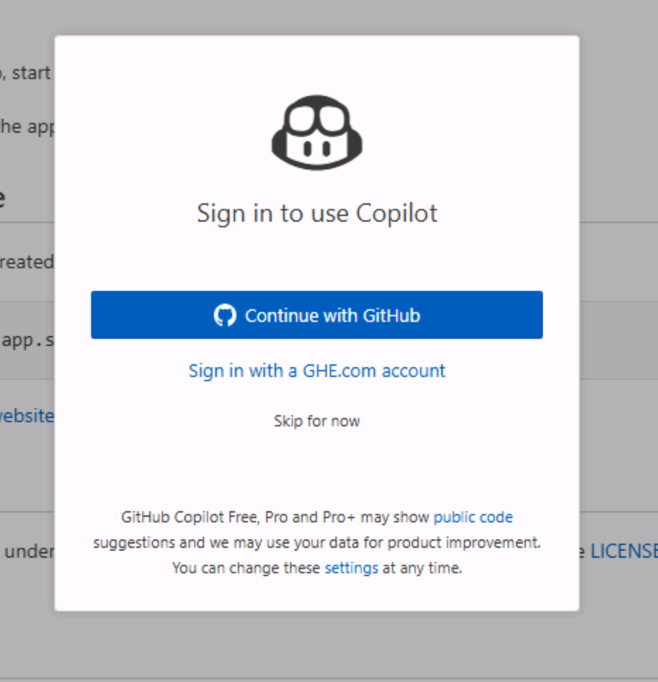

VS Code の演習を始める前に、環境を準備します。Tailspin Toys リポジトリのコピーを作成して [Codespace][codespaces] を起動し、統合開発環境 (IDE) で GitHub Copilot Chat が使えることを確認します。

## ワークショップ用リポジトリを設定する

[テンプレートリポジトリ][template-repository]から新しいインスタンスを作成します。必要なファイルが含まれ、演習を通して利用できます。

1. 新しいブラウザーウィンドウで [Tailspin Toys テンプレート][tailspin-template]を開きます。
2. **Use this template** を選択し、次に **Create a new repository** を選択します。

   

3. GitHub または Microsoft 主催のイベントで参加している場合は、メンターの指示に従います。それ以外の場合は GitHub Copilot を利用できる組織にリポジトリを作成します。

   

4. 後で使うため、作成したリポジトリのパス (**organization-or-user-name/repository-name**) を控えます。

> [!NOTE]
> **バックログは準備済みです**
>
> テンプレートからリポジトリを作成すると、GitHub Issue のバックログも自動的に作成されます。ワークショップではこの Issue に取り組むため、自分で登録する必要はありません。

## Codespace を作成する

演習では Codespace を使います。[GitHub Codespaces][codespaces] は、ブラウザーからコードの作成、実行、デバッグができるクラウド開発環境です。複数の言語、拡張機能、ツールをサポートする IDE を提供します。

1. 作成したリポジトリを開きます。
2. 緑色の **Code** ボタンを選択します。

   

3. **Codespaces** タブを選び、**+** ボタンで新しい Codespace を作成します。

   

Codespace の作成には数分かかります。必要なサービスを手動でインストールするより早く済みます。作成中は GitHub Copilot の機能を確認できます。

> [!CAUTION]
> 後の演習で Codespace に戻ります。今はブラウザーのタブで開いたままにしてください。

> [!NOTE]
> このワークショップは Codespace またはローカルの [dev container][dev-containers] で実行できます。どちらも必要な前提条件を用意します。ローカルで実行する場合は、クローンしたリポジトリを VS Code で開き、求められたら **Reopen in Container** を選択します。Codespace と同じ dev container が構築されます。

[codespaces]: https://github.com/features/codespaces
[dev-containers]: https://code.visualstudio.com/docs/devcontainers/containers

## GitHub Copilot Chat とエージェントモードを使う

Copilot Chat のエージェントモードを使うには、IDE に GitHub Copilot Chat 拡張機能が必要です。GitHub Codespace には通常すでにインストールされています。

> [!TIP]
> GitHub Copilot Chat 拡張機能がない場合は、[Visual Studio Code Marketplace からインストール][copilot-chat-extension]できます。または Visual Studio Code の Extensions ビューを開き、**GitHub Copilot Chat** を検索して **Install** を選択します。

拡張機能をインストールした後、GitHub アカウントでの認証が必要になる場合があります。

1. Codespace に戻ります。
2. エディター右側に Copilot Chat がない場合は、Codespace 上部にある **Copilot Chat** アイコンを選択します。
3. Copilot Chat に `Hello world` のようなメッセージを入力し、Enter キーを押して有効化します。
4. 未認証の場合は GitHub アカウントへのサインインが求められます。表示される手順に従って認証します。

   

5. 認証後、Copilot Chat ウィンドウが表示されることを確認します。

## まとめ

ワークショップ用リポジトリのコピーを作成し、コードを書くための Codespace の作成を開始しました。

## 次のステップ

次は Copilot にプロジェクトの慣例を伝えます。[演習 1 - カスタム指示][next-lesson]に進みます。

## リソース

- [GitHub Codespaces の概要][codespaces]
- [テンプレートからリポジトリを作成する][template-repository]
- [Codespaces のクイックスタート][codespaces-quickstart]

[tailspin-template]: https://github.com/github-samples/tailspin-toys
[template-repository]: https://docs.github.com/repositories/creating-and-managing-repositories/creating-a-template-repository
[codespaces-quickstart]: https://docs.github.com/codespaces/getting-started/quickstart
[copilot-chat-extension]: https://marketplace.visualstudio.com/items?itemName=GitHub.copilot-chat
[next-lesson]: ../1-custom-instructions/
